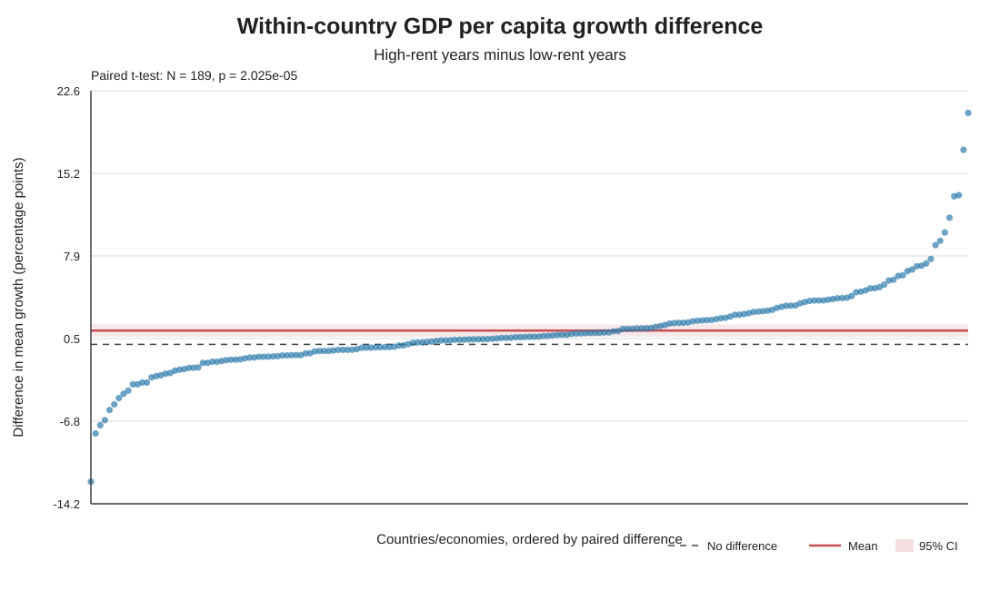

# Resource Rents and GDP per Capita Growth

## คำถามวิจัย

ภายในประเทศหรือเขตเศรษฐกิจเดียวกัน ช่วงที่รายได้จากทรัพยากรธรรมชาติเมื่อเทียบกับ GDP สูง มีการเติบโตของ GDP ต่อหัวต่างจากช่วงที่ rents ต่ำหรือไม่?

## ผลที่พบเบื้องต้น

| ช่วงวิเคราะห์ | ข้อมูลประเทศ–ปี | คู่ประเทศ/เขตเศรษฐกิจ | ผลต่างเฉลี่ย (สูง − ต่ำ) | Paired t-test |
|---|---:|---:|---:|---:|
| 2000–2021 (ช่วงหลัก) | 4,460 | 189 | +1.226 จุดเปอร์เซ็นต์ | p = 0.000020 |
| 1970–2021 (ตรวจสอบช่วงยาว) | 9,021 | 189 | +0.973 จุดเปอร์เซ็นต์ | p = 0.000485 |

ทั้งสองช่วงพบค่าเฉลี่ยการเติบโตในปี rents สูงมากกว่าปี rents ต่ำในชุดข้อมูลนี้ แต่ผลเป็นความสัมพันธ์จากข้อมูลสังเกตการณ์ จึงสรุปไม่ได้ว่า rents เป็นสาเหตุของการเติบโต

## วิธีทำแบบย่อ

ในแต่ละประเทศ ใช้ค่า rents ของประเทศนั้นแบ่งปีเป็นช่วงต่ำและสูงด้วยจุดตัดเปอร์เซ็นไทล์ 33 และ 67 ตัดช่วงกลางออก หาค่าเฉลี่ย GDP per capita growth ของแต่ละช่วง แล้วคำนวณผลต่างสูงลบต่ำหนึ่งค่าต่อประเทศ นำผลต่าง 189 คู่นี้ไปทดสอบด้วย paired t-test และใช้ Wilcoxon signed-rank เป็นการตรวจสอบเสริม

## เปิดดูข้อมูลนำเสนอ

- [สรุปวิธี ผล ข้อจำกัด และแนวแบ่งการนำเสนอ 4 คน](resource-development-project/docs/PRESENTATION_BRIEF.md)
- [คำอธิบายตัวแปรและแหล่งข้อมูล](resource-development-project/docs/DATA_DICTIONARY.md)
- [วิธีติดตั้งและทำซ้ำการวิเคราะห์](resource-development-project/README.md)
- [ตารางเปรียบเทียบผลสองช่วง](resource-development-project/data/processed/results/matched_pairs_period_comparison.csv)
- [ผลรายประเทศ](resource-development-project/data/processed/results/matched_pairs_period_country_results.csv)

> จำนวน 9,021 คือจำนวนแถวประเทศ–ปี ไม่ใช่จำนวนคู่ที่ใช้ทดสอบ คู่ที่ใช้ใน paired test มี 189 คู่ ส่วนไฟล์ WDI ระบุปี 1960–2025 แต่ตัวแปรทั้งสองมีข้อมูลร่วมจริงในช่วง 1970–2021.
