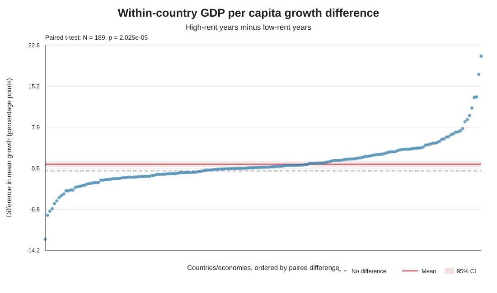

# Resource Dependence and Economic Growth

โครงงานนี้ศึกษาว่า **การเติบโตของ GDP ต่อหัวแตกต่างกันหรือไม่ ระหว่างช่วงที่ resource rents ต่ำกับสูงภายในประเทศเดียวกัน** ใช้ข้อมูล World Development Indicators (WDI) ของธนาคารโลก ช่วงปี 2000–2021

## วิธีวิเคราะห์หลัก

แต่ละประเทศเป็นคู่ของตัวเอง: แบ่งปีตาม resource rents ของประเทศนั้นเป็นกลุ่มต่ำ (หนึ่งในสามล่าง) และกลุ่มสูง (หนึ่งในสามบน) ตัดช่วงกลางออก แล้วเปรียบเทียบค่าเฉลี่ย GDP per capita growth ด้วย paired t-test ใช้ Wilcoxon signed-rank เป็นการตรวจสอบประกอบ

## ผลหลัก

| รายการ | ผล |
|---|---:|
| คู่ประเทศ/เขตเศรษฐกิจ | 189 |
| ค่าเฉลี่ยการเติบโตช่วง rents ต่ำ | 1.416% |
| ค่าเฉลี่ยการเติบโตช่วง rents สูง | 2.642% |
| ผลต่างเฉลี่ย (สูง − ต่ำ) | +1.226 จุดเปอร์เซ็นต์ |
| 95% CI | +0.673 ถึง +1.779 |
| Paired t-test | t(188) = 4.373, p = 0.000020 |
| Wilcoxon signed-rank | p = 0.000011 |

ผลแสดงความแตกต่างในข้อมูลชุดนี้ แต่ยังสรุปเหตุและผลไม่ได้

## เริ่มอ่านตรงนี้

- [คู่มือโครงงานและวิธีทำซ้ำ](resource-development-project/README.md)
- [ผลวิเคราะห์และข้อจำกัด](resource-development-project/docs/RESULTS.md)
- [คำอธิบายตัวแปรและรหัส WDI](resource-development-project/docs/DATA_DICTIONARY.md)
- [บันทึกกระบวนการทำงาน](resource-development-project/docs/PROJECT_LOG.md)
- [ข้อมูลและสคริปต์ทั้งหมด](resource-development-project/)

ตัวแปร rents วัดมูลค่าค่าเช่าทรัพยากรธรรมชาติเป็นสัดส่วนต่อ GDP ไม่ใช่ปริมาณทรัพยากรใต้ดิน โปรดอ่านข้อจำกัดก่อนนำผลไปอ้างอิง
