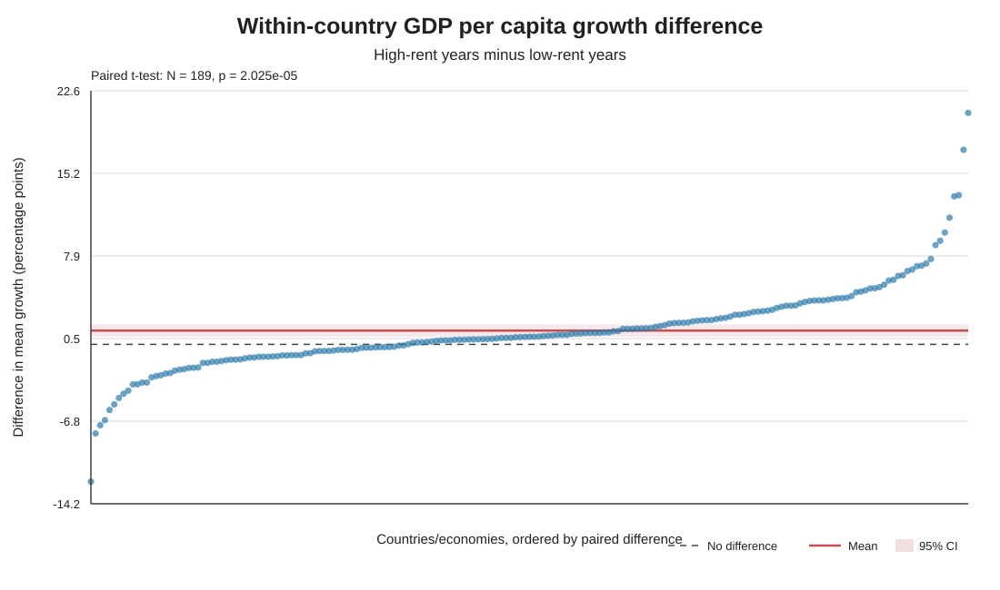

# สรุปสำหรับนำเสนอ

## 1. คำถามวิจัย

ภายในประเทศหรือเขตเศรษฐกิจเดียวกัน ช่วงที่ resource rents เมื่อเทียบกับ GDP ค่อนข้างสูง มีการเติบโตของ GDP ต่อหัวแตกต่างจากช่วงที่ rents ค่อนข้างต่ำหรือไม่?

คำถามนี้เปรียบเทียบประเทศกับตัวเองในคนละช่วงปี ไม่ได้เปรียบเทียบประเทศทรัพยากรมากกับประเทศทรัพยากรน้อย

### คำถามย่อยสำหรับนำเสนอ

1. ภายในหน่วยเศรษฐกิจเดิม ช่วง rents สูงกับต่ำมีการเติบโตต่อหัวต่างกันหรือไม่?
2. ผลต่างเฉลี่ยสูงลบต่ำมีทิศทางและขนาดเท่าใด?
3. ผลต่างเป็นบวกในกี่หน่วย และเป็นลบในกี่หน่วย?
4. ผลจาก Wilcoxon signed-rank สอดคล้องกับ paired t-test หรือไม่?
5. เมื่อใช้ช่วงข้อมูลยาวขึ้น (1970–2021) ผลยังเป็นไปในทิศทางเดิมหรือไม่?

คำถาม 1–3 เป็นผลหลักของช่วง 2000–2021; คำถาม 4–5 เป็นการตรวจสอบเสริม.

## 2. ข้อมูล

ใช้ข้อมูล World Bank WDI สองตัวแปร:

- **Total natural resources rents (% of GDP)** (`NY.GDP.TOTL.RT.ZS`): มูลค่า rents จากทรัพยากรธรรมชาติเทียบกับ GDP
- **GDP per capita growth (annual %)** (`NY.GDP.PCAP.KD.ZG`): อัตราการเติบโตของ GDP ต่อหัว

ไฟล์ดาวน์โหลดมีคอลัมน์ปี 1960–2025 แต่ข้อมูลของตัวแปรทั้งสองมีร่วมจริงในช่วง **1970–2021** ไม่มีการแทนค่าที่หายไป ใช้เฉพาะแถวที่มีข้อมูลทั้งสองตัวแปร

## 3. วิธีจับคู่แบบเข้าใจง่าย

สำหรับแต่ละประเทศ เราเรียงปีตามค่า rents ของประเทศนั้นเอง จุดตัด P33 แบ่งช่วง rents ต่ำ และ P67 แบ่งช่วง rents สูง ส่วนช่วงตรงกลางไม่นำมาเปรียบเทียบ ต้องมีอย่างน้อย 3 ปีในแต่ละกลุ่ม จากนั้นหาค่าเฉลี่ย growth ของช่วงต่ำและสูง แล้วจับคู่ค่าเฉลี่ยสองค่านั้นของประเทศเดิม

    ผลต่างของประเทศ = ค่าเฉลี่ย growth ช่วง rents สูง − ค่าเฉลี่ย growth ช่วง rents ต่ำ

มีหนึ่งผลต่างต่อหนึ่งประเทศ/เขตเศรษฐกิจ ดังนั้น N สำหรับ paired t-test คือ **189 คู่** แต่ละหน่วยมีน้ำหนักเท่ากัน

การทดสอบหลักเป็น paired t-test แบบสองด้าน:

    H₀: ค่าเฉลี่ยผลต่างของ 189 คู่ = 0
    H₁: ค่าเฉลี่ยผลต่างของ 189 คู่ ≠ 0
    t = ผลต่างเฉลี่ย ÷ (ส่วนเบี่ยงเบนมาตรฐานของผลต่าง / √189)

ใช้ Wilcoxon signed-rank test เป็นการตรวจสอบเสริมจากอันดับของผลต่าง วิธีนี้ไม่ต้องอาศัยการแจกแจงปกติแบบเดียวกับ paired t-test แต่การตีความตำแหน่งกึ่งกลางยังเกี่ยวกับข้อสมมติว่าผลต่างมีการกระจายค่อนข้างสมมาตร

## 4. ผลที่ได้

| ช่วงวิเคราะห์ | ประเทศ–ปีที่มีข้อมูลครบ | คู่ที่ทดสอบ | ค่าเฉลี่ยช่วงต่ำ | ค่าเฉลี่ยช่วงสูง | ผลต่างสูง − ต่ำ | Paired t-test | Wilcoxon p |
|---|---:|---:|---:|---:|---:|---|---:|
| 2000–2021 ช่วงหลัก | 4,460 | 189 | 1.416% | 2.642% | +1.226 จุดเปอร์เซ็นต์ | t(188)=4.373, p=0.000020; 95% CI [0.673, 1.779] | 0.000011 |
| 1970–2021 ช่วงตรวจสอบ | 9,021 | 189 | 1.519% | 2.491% | +0.973 จุดเปอร์เซ็นต์ | t(188)=3.551, p=0.000485; 95% CI [0.432, 1.513] | 0.000303 |

**วิธีอ่านกราฟ:** จุดหนึ่งจุดแทนหนึ่งประเทศ/เขตเศรษฐกิจ จุดเหนือเส้นศูนย์หมายถึง growth เฉลี่ยช่วง rents สูงมากกว่าช่วงต่ำ จุดใต้เส้นศูนย์หมายถึงต่ำกว่า

## 5. สรุปเป็นภาษาพูด

“ในชุดข้อมูลนี้ ค่าเฉลี่ย GDP ต่อหัวเติบโตในปีที่ประเทศนั้นมี resource rents สูงกว่าปีที่ rents ต่ำประมาณ 1.23 จุดเปอร์เซ็นต์ในช่วงหลัก 2000–2021 ผลทดสอบ paired t-test และ Wilcoxon ให้ผลที่มีนัยสำคัญทางสถิติที่ระดับ 5% เมื่อขยายช่วงข้อมูลย้อนหลัง ผลต่างยังเป็นบวกประมาณ 0.97 จุดเปอร์เซ็นต์ อย่างไรก็ตาม การเปรียบเทียบนี้เป็นความสัมพันธ์ ไม่ได้พิสูจน์ว่า rents ทำให้เศรษฐกิจเติบโต”

ที่ระดับนัยสำคัญ 5% ผลทดสอบทั้งสองช่วงไม่สอดคล้องกับสมมติฐานว่าผลต่างเฉลี่ยเป็นศูนย์ แต่การปฏิเสธ H₀ ไม่ได้หมายความว่าพิสูจน์เหตุและผลแล้ว

## 6. ทำไมจำนวน N ไม่ใช่ 9,021

9,021 คือจำนวนแถวประเทศ–ปีที่มีข้อมูลครบในช่วงยาว ส่วน paired t-test เริ่มจากหาค่าเฉลี่ยต่ำและสูง แล้วเหลือผลต่างเพียงหนึ่งค่าต่อประเทศ จึงมี 189 คู่ ทั้งช่วงหลักและช่วงยาว มี 5 จาก 217 หน่วยที่ไม่มีข้อมูลร่วม; ช่วงหลักมีอีก 22 หน่วยที่จุดตัดต่ำกับสูงแยกกันไม่ได้ และ 1 หน่วยมีปีในกลุ่มไม่พอ ส่วนช่วงยาวมี 23 หน่วยที่จุดตัดแยกกันไม่ได้

การขยายช่วงทำให้มีจำนวนปีต่อประเทศมากขึ้น แต่ไม่ได้เพิ่มจำนวนประเทศคู่ที่นำไปทดสอบ จึงช่วยตอบข้อกังวลเรื่องระยะเวลาที่สังเกตประเทศได้บางส่วน แต่ไม่ได้เพิ่ม N ของ paired test

## 7. ข้อจำกัดที่ควรบอก

- เกณฑ์ rents ต่ำ/สูงเป็นเกณฑ์สัมพัทธ์ภายในแต่ละหน่วย จุดตัดแต่ละประเทศไม่จำเป็นต้องเท่ากัน
- เมื่อเปลี่ยนช่วงปี จุดตัด P33/P67 ก็เปลี่ยนตาม จึงเป็นการตรวจสอบความไว ไม่ใช่ตัวอย่างใหม่ที่เป็นอิสระ
- ปี rents สูงกับต่ำอาจเกิดคนละยุค จึงอาจมีวิกฤต ราคาทรัพยากร หรือเหตุการณ์อื่นปะปน การทดสอบนี้ไม่ได้ควบคุมเหตุการณ์เฉพาะปี
- paired t-test ต้องอาศัยการกระจายของผลต่างระหว่างประเทศที่เหมาะสม; Wilcoxon ใช้เป็นการตรวจสอบเสริม ไม่ได้ลบข้อจำกัดเรื่องปีและปัจจัยอื่น
- เป็นข้อมูลสังเกตการณ์ จึงสรุปเหตุและผลไม่ได้ และไม่ควรอ้างว่าแทนทุกประเทศทั่วโลกโดยไม่มีข้อจำกัด

## 8. แบ่งเนื้อหาสำหรับกลุ่ม 4 คน

1. **คนที่ 1 — ที่มาและคำถาม:** อธิบาย resource rents กับเหตุผลที่ดูการเติบโตต่อหัว
2. **คนที่ 2 — แหล่งและตัวแปร:** อธิบาย WDI, สอง series, ช่วงปีที่ข้อมูลมีจริง และ missing values
3. **คนที่ 3 — วิธีจับคู่และสูตร:** สาธิตการแบ่งต่ำ/กลาง/สูงภายในประเทศเดียวกัน แล้วอธิบาย dᵢ, H₀/H₁ และ paired t-test
4. **คนที่ 4 — ผล กราฟ และข้อจำกัด:** อธิบายผลต่าง ค่า p, จำนวน 189 คู่ และย้ำว่าเป็นความสัมพันธ์ไม่ใช่เหตุและผล

## 9. ไฟล์ที่ควรเปิดประกอบ

- [สไลด์นำเสนอภาษาไทย (PowerPoint)](resource-rents-gdp-growth-presentation.pptx)
- ตารางผลรวม: [matched_pairs_period_comparison.csv](../data/processed/results/matched_pairs_period_comparison.csv)
- ผลรายประเทศ: [matched_pairs_period_country_results.csv](../data/processed/results/matched_pairs_period_country_results.csv)
- แหล่งและนิยามตัวแปร: [DATA_DICTIONARY.md](DATA_DICTIONARY.md)
- โค้ดที่ใช้สร้างผล: [matched_pairs_period_sensitivity.py](../matched_pairs_period_sensitivity.py)
