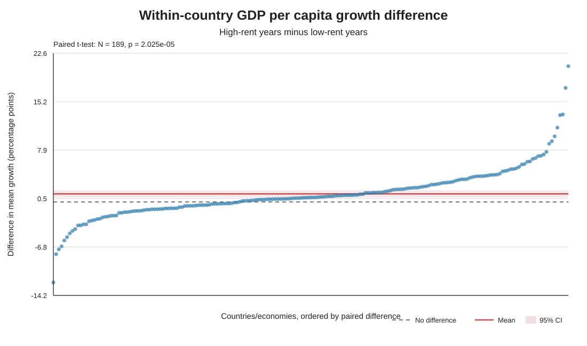

# ผลวิเคราะห์หลัก

## คำถามที่ทดสอบ

ภายในประเทศ/เขตเศรษฐกิจเดียวกัน ค่าเฉลี่ย GDP per capita growth แตกต่างกันหรือไม่ ระหว่างปีที่ resource rents อยู่ในกลุ่มต่ำกับกลุ่มสูง?

ใช้ข้อมูล WDI ช่วงปี 2000–2021 ตัวแปรหลักคือ Total natural resources rents (% of GDP) และ GDP per capita growth (annual %)

## วิธีจับคู่

ประเทศหนึ่งประเทศเป็นหนึ่งคู่ของตัวเอง ในแต่ละหน่วย คำนวณเปอร์เซ็นไทล์ที่ 33 และ 67 ของ resource rents จากปีที่มีข้อมูลทั้ง rents และ growth ครบ ปีที่ rents ไม่เกินจุดตัดล่างเป็นกลุ่มต่ำ ปีที่ rents ไม่น้อยกว่าจุดตัดบนเป็นกลุ่มสูง และตัดช่วงกลางออก ต้องมีอย่างน้อย 3 ปีต่อกลุ่ม

คำนวณผลต่างรายประเทศ:

    ผลต่าง = ค่าเฉลี่ย growth ช่วง rents สูง − ค่าเฉลี่ย growth ช่วง rents ต่ำ

จากนั้นใช้ paired t-test แบบสองด้าน ทดสอบว่าเฉลี่ยของผลต่างเท่ากับศูนย์หรือไม่ ที่ระดับนัยสำคัญ 5% แต่ละประเทศมีน้ำหนักเท่ากัน

## กลุ่มตัวอย่าง

มี 4,460 country-years ที่มีข้อมูลทั้งสองตัวแปร จาก 217 หน่วยใน panel มี 5 หน่วยที่ไม่มีปีข้อมูลครบทั้งสองตัวแปร; ใน 212 หน่วยที่เหลือ มี 22 หน่วยที่จุดตัดต่ำกับสูงแยกกันไม่ได้ และ 1 หน่วยมีปีข้อมูลไม่พอ จึงเหลือ **189 คู่**

## ผล

| สถิติ | ผล |
|---|---:|
| ค่าเฉลี่ย growth ช่วง rents ต่ำ | 1.416% |
| ค่าเฉลี่ย growth ช่วง rents สูง | 2.642% |
| ผลต่างเฉลี่ย (สูง − ต่ำ) | +1.226 จุดเปอร์เซ็นต์ |
| SD ของผลต่าง | 3.854 จุดเปอร์เซ็นต์ |
| 95% CI | +0.673 ถึง +1.779 จุดเปอร์เซ็นต์ |
| Paired t-test | t(188) = 4.373, p = 0.000020 |
| Wilcoxon signed-rank sensitivity | p = 0.000011 |
| Cohen's dz | 0.318 |

ที่ระดับ 5% ปฏิเสธสมมติฐานว่าผลต่างเฉลี่ยเป็นศูนย์ในชุดข้อมูลนี้ ผลต่างเฉลี่ยเป็นบวก หมายถึงค่าเฉลี่ยการเติบโตช่วง rents สูงมากกว่าช่วง rents ต่ำประมาณ 1.23 จุดเปอร์เซ็นต์

## ตรวจสอบความไวเมื่อขยายช่วงปี

ใช้ไฟล์ WDI ที่มีคอลัมน์ปี 1960–2025 แต่เมื่อเลือกเฉพาะปีที่มีข้อมูลครบทั้ง rents และ GDP per capita growth ช่วงร่วมที่มีจริงคือ 1970–2021 การจัดกลุ่ม P33/P67 คำนวณใหม่ภายในประเทศสำหรับแต่ละช่วง และยังต้องมีอย่างน้อย 3 ปีต่อกลุ่ม

| ช่วงวิเคราะห์ | ประเทศ–ปีครบ | คู่ที่วิเคราะห์ | เฉลี่ยช่วงต่ำ | เฉลี่ยช่วงสูง | ผลต่างสูง − ต่ำ | Paired t-test | Wilcoxon p |
|---|---:|---:|---:|---:|---:|---|---:|
| 2000–2021 (ช่วงหลัก) | 4,460 | 189 | 1.416% | 2.642% | +1.226 จุดเปอร์เซ็นต์ | t(188)=4.373, p=0.000020; 95% CI [0.673, 1.779] | 0.000011 |
| 1970–2021 (ช่วงร่วมที่ยาวที่สุด) | 9,021 | 189 | 1.519% | 2.491% | +0.973 จุดเปอร์เซ็นต์ | t(188)=3.551, p=0.000485; 95% CI [0.432, 1.513] | 0.000303 |

ข้อมูลรายปีเพิ่มขึ้น แต่ N ของ paired test ยังคงเป็น 189 คู่ เพราะแต่ละประเทศยังให้ผลต่างหนึ่งค่า ไม่ควรเรียก 9,021 ประเทศ–ปีว่า N ของ t-test ผลช่วงยาวมีทิศทางบวกและยังมีนัยสำคัญที่ 5% แต่ผลต่างเฉลี่ยเล็กลง การวิเคราะห์นี้เป็น sensitivity check ที่ช่วงปีซ้อนกับผลหลัก ไม่ใช่การยืนยันจากตัวอย่างอิสระชุดใหม่

## อ่านกราฟ

จุดหนึ่งจุดแทนผลต่างของหนึ่งประเทศ/เขตเศรษฐกิจ เส้นศูนย์หมายถึงไม่มีผลต่าง จุดเหนือเส้นศูนย์คือ growth เฉลี่ยช่วง rents สูงมากกว่า

## ข้อจำกัด

- กลุ่ม rents ต่ำ/สูงเป็นการจัดอันดับ **ภายในแต่ละประเทศ** จึงเป็นช่วงสัมพัทธ์ ไม่ใช่เกณฑ์ค่า rents เดียวกันทั่วโลก
- การตัดช่วงกลางออกทำให้ไม่ได้ใช้ทุกปี และผลอาจเปลี่ยนได้หากเปลี่ยนจุดตัด
- paired t-test ทดสอบค่าเฉลี่ยผลต่าง; Wilcoxon เป็นการตรวจสอบแบบจัดอันดับและไม่ได้ทดสอบพารามิเตอร์เดียวกันทุกประการ
- การจับคู่ช่วยเทียบประเทศกับตัวเอง แต่ไม่ได้ควบคุมเหตุการณ์ร่วมในแต่ละปีหรือปัจจัยอื่นที่เปลี่ยนตามเวลา
- ข้อมูลเป็นข้อมูลสังเกตการณ์ จึงสรุปเหตุและผลไม่ได้
- ผล regression ก่อนหน้าเป็นการสำรวจ ไม่ใช่ผลหลักของวิธีที่ปรับใหม่

ไฟล์สรุป ตัวเลขรายประเทศ และรายงานข้อความอยู่ใน [โฟลเดอร์ผลลัพธ์](../data/processed/README.md)
